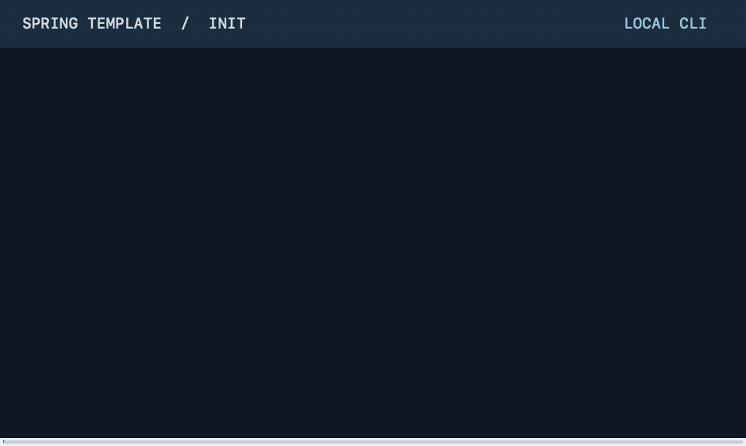
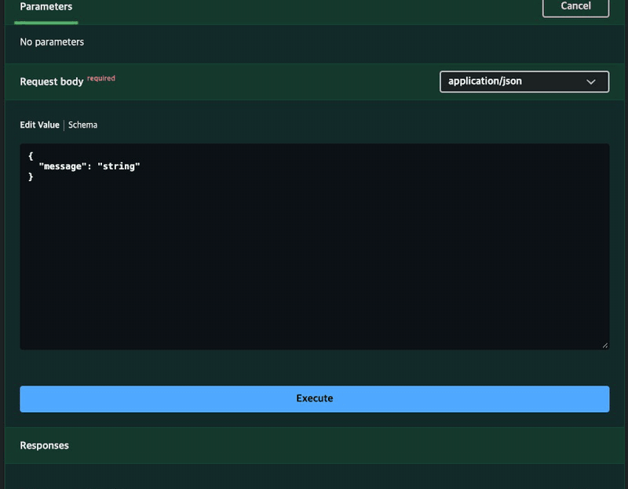
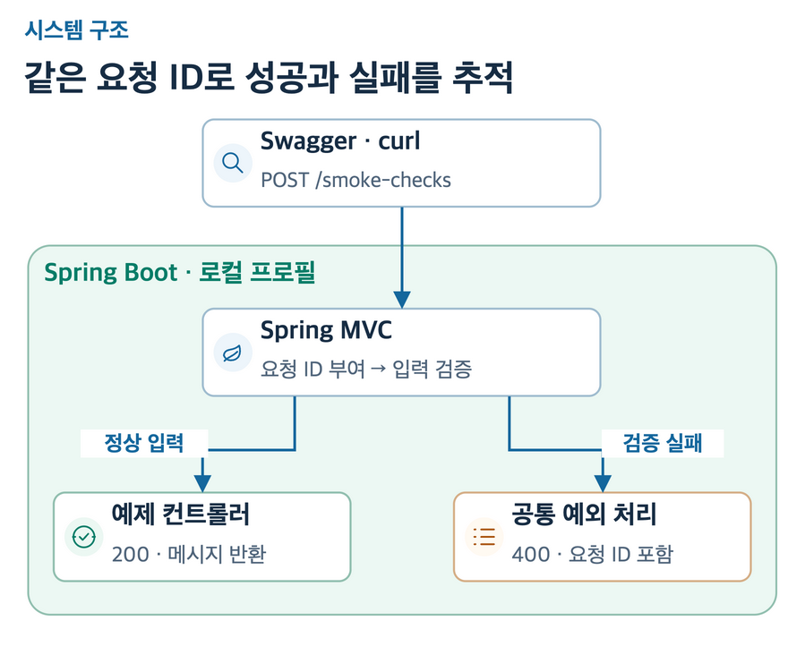
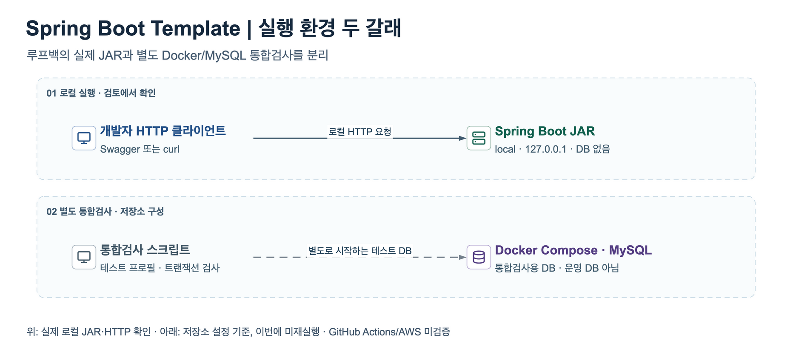
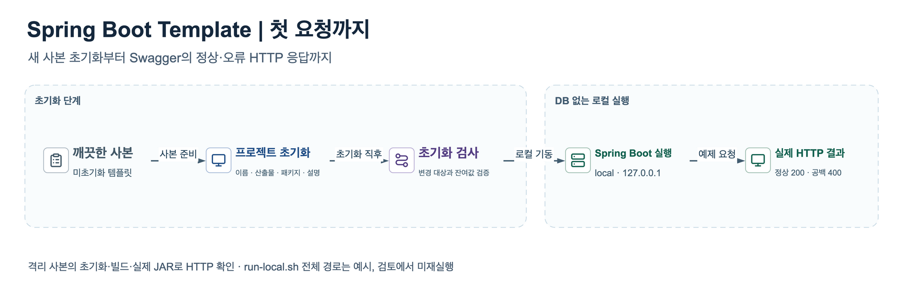

# Spring Boot Template

## 개요

새 Spring REST 서버에서 프로젝트 이름과 Java 패키지를 정하면, **DB나 배포 계정을 준비하기 전에 첫 요청과 오류 응답부터 확인할 수 있는 템플릿**이다. 서비스의 도메인 모델은 미리 정하지 않고, 초기화 방법·응답 형식·실행 프로필·검증 도구를 재사용할 수 있게 만들었다.

## 프로젝트 정보와 담당 범위

| 항목 | 내용 |
|---|---|
| 프로젝트 | Spring Boot Template · 개인 프로젝트 |
| 사용 대상 | 새 Spring REST 서비스를 시작하거나 공통 HTTP 규칙을 학습하는 개발자 |
| 주요 기술 | Java 25, Spring Boot 4.1.0 · Spring MVC, Gradle Kotlin DSL, springdoc · OpenAPI 3.1, Spotless |
| 실행 기준 | 로컬 커밋 `3132cdf`. 기본 실행은 DB 없이 루프백에서 시작하며 MySQL 검증은 별도 |

### 담당 범위

- 새 프로젝트의 이름·빌드 산출물·Java 패키지를 바꾸는 초기화와, 초기화 직후 및 개발 중 검사의 기준 설계·구현
- 정상 응답과 공통 오류 JSON, `X-Request-Id`, Swagger/OpenAPI 검증으로 이어지는 REST 계약 구성
- DB 없는 로컬 실행 경로, Docker Compose 기반 MySQL 통합검사, ARM64 CI·단일 EC2 운영 설정 마련

## 문제 정의

새 서버마다 Java 패키지와 산출물 이름을 바꾸고, 오류 형식과 로그 규칙을 다시 정하면 첫 기능을 만들기 전에 같은 작업을 반복한다. 그렇다고 시작부터 데이터베이스까지 요구하면 **첫 API 응답이 나오는지** 확인하기 위해 Docker나 별도 설정을 준비해야 한다.

초기화와 첫 실행을 작게 유지하고, DB 트랜잭션이나 배포처럼 환경이 필요한 검증은 별도 경로로 뒀다. 초기화 직후에는 이름이 빠짐없이 바뀌었는지 엄격히 확인하되, 이후 개발자가 파일을 수정하는 것은 정상적인 상태로 인정한다.

## 개발 단계에 따라 나뉘는 사용 흐름

| 작업 | 시작 | 확인할 결과 |
| --- | --- | --- |
| **새 저장소 준비** | 깨끗한 템플릿에 프로젝트 이름·패키지 입력 | 패키지 경로와 산출물 이름이 바뀌고 초기화 검증이 통과 |
| **첫 HTTP 확인** | DB 없이 로컬 서버를 띄워 Swagger에서 호출 | HTTP 200, 입력 오류 400, 응답과 오류 본문의 같은 요청 ID |
| **데이터 계층 검증** | Compose MySQL에서 별도 통합 테스트 실행 | 두 저장소 쓰기가 함께 커밋되거나 실패 시 함께 롤백 |

### 새 저장소에 이름과 패키지 적용하기



깨끗한 템플릿에서 `Parcel Service` 정보를 넣고 초기화한다. 검사 스크립트가 정상 완료를 확인하면, 프로젝트 ID는 `parcel-service`, Java 패키지는 `io.example.parcel`로 바뀐다. [초기화 출력](docs/portfolio-readme/evidence/init-flow.txt)

### 로컬 Swagger에서 첫 요청 보내기



택배 수령 안내 API를 붙이기 전, 개발자가 Swagger의 테스트 경로에 안내 문구를 보내 응답 형식을 확인한다. 같은 필드를 공백으로 보내면 400 응답에 잘못된 항목과 요청 ID가 표시된다.

### HTTP 계약에서 확인할 내용

1. 정상 요청 `{"message":"Package 4821 is ready for pickup."}`에는 HTTP 200과 같은 메시지를 돌려준다.
2. 공백 메시지는 HTTP 400과 `VALIDATION_FAILED`를 반환한다.
3. 오류 본문과 응답 헤더의 요청 ID가 같다. 실패한 요청을 확인할 때 같은 식별자를 쓸 수 있다.

`/smoke-checks`는 템플릿의 HTTP 계약을 확인하는 예제다. 제품 데이터를 저장하지 않고 운영 프로필에는 등록되지 않는다.

[MP4로 보기](docs/portfolio-readme/assets/swagger-demo.mp4) · [정상 응답 화면](docs/portfolio-readme/assets/swagger-success.png) · [입력 오류 화면](docs/portfolio-readme/assets/swagger-validation.png) · [실제 HTTP 결과](docs/portfolio-readme/evidence/http.txt)

### 개발자 · MySQL 통합 테스트로 쓰기 경계 확인하기

기본 HTTP 확인과 별도로 일회용 MySQL을 띄워 테스트한다. 두 저장소의 쓰기를 하나의 애플리케이션 서비스 메서드에서 실행한다. 성공 때 두 기록이 같이 남는지, 다음 저장소에서 오류가 나면 앞선 쓰기까지 사라지는지 확인한다.

```bash
scripts/run-integration-tests.sh
```

[MySQL 검증 기록](docs/portfolio-readme/evidence/mysql-flow.md)

## 아키텍처

### 시스템 구조: 한 요청에서 두 응답까지



[편집 원본](docs/portfolio-readme/assets/spring-system.drawio)

### 실행 환경: 루프백과 별도 DB 통합검사



[편집 원본](docs/portfolio-readme/assets/spring-environment.drawio)

### 워크플로우: 템플릿 사본에서 첫 요청까지



[편집 원본](docs/portfolio-readme/assets/startup-flow.drawio)

| 구분 | 실행 흐름 |
|---|---|
| 초기화 | 깨끗한 사본에서 프로젝트명, 산출물명, Java 패키지, 설명을 한 번 설정한다. |
| 기본 실행 | Spring Boot의 `local` 프로필이 `127.0.0.1`에서 실행된다. 상태 점검, Swagger, 예제 API 확인에 Docker나 DB가 필요하지 않다. |
| DB 통합검사 | Docker Compose와 MySQL을 쓰는 별도 경로다. 템플릿용 테스트 데이터로 트랜잭션 경계를 검사하고, 제품 스키마와 마이그레이션은 새 서비스에서 정한다. |
| 배포 준비 | ARM64 GitHub Actions와 단일 EC2 배포용 설정·스크립트가 있다. |

## 기술적 의사결정

### 이름 바꾸기는 한 번의 초기화, 이후 개발은 별도로 검사하기

GitHub 템플릿을 복제해도 Java 패키지, 프로젝트명, JAR 산출물 이름은 그대로다. 저장소 전체의 문자열을 한번에 바꾸면 예전 설계 문서나 바꾸면 안 되는 파일까지 덮는다. 그래서 초기화 스크립트는 매니페스트에 적힌 대상과 등장 횟수만 검사하고, 패키지 폴더의 이동과 대상 경로 충돌을 실제 파일 변경 전에 계산한다.

먼저 별도 사본에서 변경을 검증하고, 기존 파일을 복구할 수 있는 기록을 남기면서 새 파일을 옮긴다. 마지막에만 초기화 완료 표시를 쓴다. 이때 통과한 지문을 로컬 실행 때마다 다시 요구하면 개발자가 정상적으로 코드를 수정해도 서버를 못 띄운다. 그래서 초기화 직후의 엄격한 검사와 실행에 필요한 조건만 보는 `--runtime-ready`를 분리했다. 실제 사본에서 초기화 직후 엄격 검사가 통과하고, 정상 Java 변경 뒤에는 실행 준비 검사만 통과하는 것을 확인했다.

### 첫 API는 DB 없이, 트랜잭션은 실제 MySQL로 확인하기

새 프로젝트가 첫 요청을 처리하는지 보려고 매번 Docker와 스키마를 먼저 준비하고 싶지는 않았다. 그렇다고 DB 동작을 H2만으로 대체하면 MySQL의 설정과 엔진 동작을 확인할 수 없다. 기본 실행 프로필에서는 데이터소스 자동 설정을 끈다. DB를 쓰는 프로필은 별도로 켜고, 제품 스키마나 마이그레이션 방식은 그 서비스를 만들 때 정한다.

Compose MySQL을 사용하는 통합 테스트는 공개 서비스 메서드 하나에서 두 저장소에 쓰기를 수행합니다. 성공하면 두 건이 함께 남고, 두 번째 쓰기가 실패하면 첫 번째 쓰기도 롤백됩니다. 기본 빌드와 Swagger 실행에는 Docker가 필요하지 않습니다.

### 요청을 찾을 수 있게 하되, 입력값을 로그에 남기지 않기

요청에 실패하면 클라이언트가 받은 오류와 서버 로그를 서로 찾아야 한다. 사용자 입력이나 오류 원문을 그대로 로그에 적지 않고도 같은 요청을 찾도록 `X-Request-Id`를 설계했다. 길이와 문자가 허용 규칙에 맞는 ID만 사용하고, 없거나 다른 형태면 새로 발급한다. 같은 값을 응답 헤더, 오류 본문, MDC에 넣고 요청이 끝나면 MDC에서 제거한다.

매핑과 Swagger 문서의 책임은 API 인터페이스 한곳에 둔다. 컨트롤러와 문서에 같은 형식을 따로 쓰면 실제 계약이 달라져도 발견하기 어렵기 때문이다. 생성한 OpenAPI의 응답 형식과 예시를 기준 파일과 비교하고, 별도 HTTP 검증으로 **200 정상 응답, 400 오류와 같은 요청 ID**를 확인했다. 예제 엔드포인트와 Swagger는 개발 프로필의 확인 도구로 두고 제품 API는 가정하지 않는다.

### 배포 설정에는 정상 전환과 복구 동작을 함께 넣기

CI와 운영 호스트를 ARM64와 Java 25로 맞추고, 배포할 JAR과 명세만 아티팩트로 남기게 했다. 단일 EC2용 스크립트는 기존 JAR을 바로 덮지 않는다. 체크섬을 확인한 새 파일로 링크를 바꾸고, systemd로 재시작한 후 상태를 확인한다. 새 버전이 상태 검사를 통과하지 않으면 이전 JAR과 설정으로 링크를 되돌리는 구조다.

애플리케이션 값은 SSM 명령에 인자로 싣지 않고, 배포 파일 전달과 호스트의 환경 파일 갱신을 다른 단계로 뒀다. 운영 호스트에서 이 구성을 재사용해도 봐야 할 지점이 명확하도록, 템플릿에 CI·호스트 설정과 전환 순서를 함께 뒀다.

## 검증과 실행

아래는 템플릿을 새 프로젝트로 초기화해 실행하는 안내다. ARM64 macOS/Linux에서 깨끗한 사본과 Python 3.10 이상, `curl`, `rg`, `tar`, `shasum`, `awk`, 최초 다운로드용 인터넷 연결이 필요하다. 래퍼가 Corretto 25를 준비한다.

```bash
python3 scripts/init-template.py \
  --project-name="Parcel Service" \
  --artifact-name=parcel-service \
  --base-package=io.example.parcel \
  --description="Parcel pickup and tracking API"

python3 scripts/verify-template-init.py
SERVER_PORT=9090 scripts/run-local.sh
```

다른 터미널에서 요청을 보내거나 로컬 [Swagger UI](http://127.0.0.1:9090/swagger-ui.html)를 연다.

```bash
curl -i -H 'Content-Type: application/json' \
  -H 'X-Request-Id: readme-probe' \
  -d '{"message":"Package 4821 is ready for pickup."}' \
  http://127.0.0.1:9090/smoke-checks
```

```text
HTTP 200
X-Request-Id: readme-probe
{"message":"Package 4821 is ready for pickup."}
```

- **초기화와 빌드:** `parcel-service` 초기화 후 `spotlessCheck build`, 기본 Java 테스트 30건, OpenAPI 생성 검사 및 기준 사양 비교가 통과했다. 빌드한 JAR을 `local`로 실행해 Swagger, 상태 확인과 OpenAPI 명세도 열었다.
- **검사 경계 확인:** 초기화 직후에는 엄격 검사가 통과했다. 정상적인 Java 소스 변경 뒤에는 엄격 검사만 실패하고 `--runtime-ready`는 통과했다.

[실제 출력과 재현 범위](docs/portfolio-readme/evidence/verification.md) · [초기화 검사 출력](docs/portfolio-readme/evidence/init.txt) · [프로젝트별 검수표](docs/portfolio-readme/evidence/review-checklist.md)
